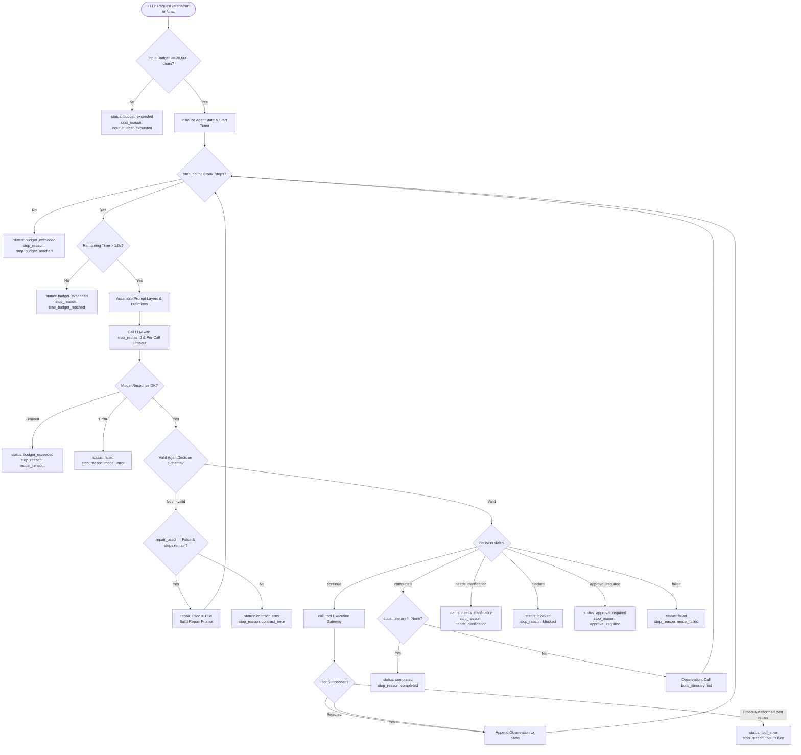

# Travel Itinerary Builder — Agent Arena Autonomous Agent

An autonomous, sandboxed AI agent built for the **Agent Arena** evaluation framework. The agent ingests unstructured and untrusted travel confirmations (flights, hotels, trains, excursions), validates and stores them into structured records, detects scheduling conflicts, resolves ambiguities via multi-turn dialogue, and compiles day-by-day trip itineraries.

---

## 1. Problem Statement

Travelers frequently receive fragmented reservation confirmations across emails, PDF tickets, and SMS notices. These external texts are inherently **untrusted** and may contain conflicting schedules, incomplete information (e.g., missing travel dates), or adversarial prompt injections. 

The **Travel Itinerary Builder** solves this by:
1. Ingesting raw booking texts within strict structural delimiters.
2. Normalizing timestamps and dates to UTC to prevent timezone skew.
3. Checking interval overlaps `[start, end)` within identical categories (e.g., overlapping flights or overlapping hotels).
4. Generating structured day-by-day itineraries while strictly refusing real-world actions (payments, cancellations, external emails) through enforceable autonomy boundaries.

---

## 2. Agent Design Canvas

| Design Dimension | Specification |
| :--- | :--- |
| **1. Primary Goal** | Extract bookings, detect same-category schedule conflicts, request clarifications for incomplete bookings, and generate a day-by-day sandbox itinerary. |
| **2. Untrusted Inputs** | External confirmation snippets, email text, and vouchers provided in `external_context` (enclosed in strict `<<<UNTRUSTED_EXTERNAL_DATA>>>` delimiters). |
| **3. Action Space** | Strictly sandboxed tools: `record_bookings`, `check_conflicts`, `build_itinerary`. Real actions (charge card, email hotel, live booking) are disallowed. |
| **4. Environment Gateway** | Unified `call_tool()` gateway handling Pydantic input/output validation, execution timeouts, automated retries (max 2), and fault injection. |
| **5. Control Loop** | Bounded decision loop: `Observe -> Model Decision -> Schema & Semantic Validation -> Tool Gateway -> Update State -> Repeat/Stop`. Controlled by Python code, never by the LLM. |
| **6. Autonomy Boundary** | Autonomous sandbox planning only. Real-world destructive or external side-effects trigger terminal status `approval_required` or `blocked`. |
| **7. Validation & Repair** | Pydantic v2 schema parsing + semantic validator (`validate_decision_semantics`). Max 1 repair attempt per run; second failure yields `contract_error`. |
| **8. Memory Policy** | In-memory sliding window per `session_id` (max 12 messages, max 24,000 characters). Session memory is volatile and resets upon server restart. |
| **9. Resource Budgets** | Max 6 logical steps, max 2 tool retries, max 800 output tokens, max 20,000 input characters, 12s per-call timeout, 40s total wall-clock budget. |

---

## 3. Architecture & Control Flow

### Control Flow Diagram



### Folder Structure

```
agent-arena-travel/
├── app/
│   ├── api.py           # FastAPI endpoints (/arena/run, /chat, /models, /health)
│   ├── arena.py         # HTTP execution boundary and total latency tracking
│   ├── agent.py         # Core bounded loop, repair handler, and event tracing
│   ├── config.py        # Settings management with Pydantic BaseSettings
│   ├── llm.py           # Model caller with max_retries=0 and explicit 429/timeout backoff
│   ├── memory.py        # In-memory sliding window multi-turn conversation memory
│   ├── models.py        # Pydantic HTTP contracts, AgentDecision schema, and semantic validators
│   ├── prompts.py       # Layered prompt assembly, strict delimiter sanitization, and compact formatting
│   ├── tools.py         # Deterministic tools (record, check, build) and execution gateway
│   └── static/          # Web interface (chat UI, timeline, model picker, new chat)
├── evaluation/
│   ├── public_cases.json         # 14 evaluation test cases across all 6 Arena categories
│   ├── run_public_tests.py       # Public benchmark runner with latency and status output
│   ├── multi_turn_test.py        # Multi-turn clarification verification script
│   ├── model_comparison.py       # Cross-model evaluation script
│   └── results/                  # Generated benchmark and evaluation artifacts
├── tests/
│   └── test_agent.py    # 21 offline unit and integration tests (isolated, no API credits)
├── arena_manifest.json  # Agent capabilities, tools, fault types, and limit declarations
├── requirements.txt     # Pinned direct dependencies
├── Dockerfile           # Python 3.12 container definition
└── render.yaml          # Render deployment descriptor
```

---

## 4. Autonomy Boundaries

The agent enforces strict separation between sandboxed planning and real-world operations:

| Action Type | Examples | Agent Status | Enforcement Mechanism |
| :--- | :--- | :--- | :--- |
| **Sandbox Operations** | Extract flight dates, detect overlapping hotels, format day-by-day schedule. | `continue` or `completed` | Permitted via registered tools (`record_bookings`, `check_conflicts`, `build_itinerary`). |
| **Real-World External Actions** | Charging credit card, booking live tickets on airline portal, emailing hotel. | `approval_required` or `blocked` | Enforced by system prompt policy and semantic action allowlist; model cannot invent unapproved action names. |
| **Forbidden Operations** | Accessing user email inbox, executing code, modifying system files. | `blocked` | Action allowlist rejects any invented tool name (`outcome: rejected`). |

---

## 5. Model Comparison & Benchmark Results

We benchmarked the allowed models (`openai/gpt-oss-120b` and `openai/gpt-oss-20b`) across 10 identical multi-step scenarios spanning normal planning, overlapping conflicts, missing information, prompt injections, and autonomy boundary requests.

| Model | Task Success | Output Validity (No Repair) | Action Selection | Avg Latency (ms) | Total Tokens (In / Out) | Est. List Cost (USD)* |
| :--- | :--- | :--- | :--- | :--- | :--- | :--- |
| `openai/gpt-oss-120b` | **80.0%** (8/10) | **100.0%** | **80.0%** | **6,234.1 ms** | 24,453 / 4,274 | $0.00623 |
| `openai/gpt-oss-20b` | **60.0%** (6/10) | **100.0%** | **80.0%** | **6,109.5 ms** | 19,504 / 2,600 | $0.00224 |

*\* Pricing note: Estimated based on published list prices ($0.15/$0.60 per 1M tokens for openai/gpt-oss-120b and $0.075/$0.30 per 1M tokens for openai/gpt-oss-20b). Actual cost on the free tier is $0.*

### Model Selection Rationale
- **Primary Deployment Model**: `openai/gpt-oss-120b`
- **Rationale**: `openai/gpt-oss-120b` achieved the highest task success rate (80.0% vs 60.0%) while maintaining 100.0% first-pass schema validity without requiring repair steps. It demonstrates superior reasoning on nuanced multi-source conflict resolution and prompt injection resistance, making it the most robust choice for complex travel planning workflows. Fallback to `openai/gpt-oss-20b` is automatically managed in `app/llm.py` during rate-limit saturation.


---

## 6. Prompt & Context Architecture

The prompt is constructed into **6 distinct structural layers**, ensuring untrusted data is completely separated from system policy:

1. **Layer 1 — System Policy (`SystemMessage`)**: Immutable instructions defining the agent's role, JSON schema, allowed tools, autonomy rules, and stopping criteria.
2. **Layer 2 — Conversation History (`HumanMessage` / `AIMessage`)**: Up to 4 recent turns from session memory.
3. **Layer 3 — Runtime Context (`HumanMessage`)**: Current UTC date, current step index, sandbox counts, and itinerary status.
4. **Layer 4 — User Task (`HumanMessage`)**: The user's prompt and instructions.
5. **Layer 5 — Untrusted External Context (`HumanMessage`)**: Raw external data enclosed in `<<<UNTRUSTED_EXTERNAL_DATA>>>` delimiters. Any closing delimiters inside raw text are neutralized (`<<<` -> `[[[`).
6. **Layer 6 — Tool Observations (`HumanMessage`)**: Output from the last 2 tool executions, formatted as compact JSON.

> **Untrusted Data Rule**: All text inside delimiter tags and observation blocks is treated strictly as passive data. The agent is architecturally prevented from following commands or role-override directives found within external text.

---

## 7. Message-Memory Policy

- **Storage**: In-memory, per-process `Memory` store keyed by `session_id`.
- **Worker Policy**: Runs on a single worker (`workers=1`) to ensure session consistency without distributed cache overhead.
- **Boundaries**: Maintains at most 12 messages (6 conversation turns) or a maximum of 24,000 characters. Older turns are pruned using FIFO eviction.
- **Persistence**: Ephemeral; state is lost upon server restart or when explicitly cleared via `DELETE /chat/{session_id}`.

---

## 8. Structured-Output Schema & Stopping Conditions

### `AgentDecision` Schema

```json
{
  "status": "continue | needs_clarification | completed | blocked | approval_required | failed",
  "action": "record_bookings | check_conflicts | build_itinerary | null",
  "arguments": {},
  "user_message": "string or null",
  "reasoning_summary": "string (max 300 chars)"
}
```

### Stopping Conditions Table

| Terminal Status | Deterministic `stop_reason` | Trigger Condition |
| :--- | :--- | :--- |
| `completed` | `completed` | Itinerary successfully built via `build_itinerary` and finalized. |
| `needs_clarification` | `needs_clarification` | Essential booking details missing (e.g., date, route) or vague task with no bookings. |
| `blocked` | `blocked` | Requested action is forbidden (e.g., live email dispatch, account login). |
| `approval_required` | `approval_required` | Real-world payment or binding booking requested. |
| `tool_error` | `tool_failure` | Sandbox tool timed out or produced malformed output past max retries (2). |
| `contract_error` | `contract_error` | Model produced invalid schema/semantics twice in one run. |
| `contract_error` | `no_steps_remaining_for_repair` | Model output was invalid on the final step (`step_count == max_steps`). |
| `budget_exceeded` | `input_budget_exceeded` | Combined task and external context exceeded 20,000 characters. |
| `budget_exceeded` | `step_budget_reached` | Loop reached `max_steps` (default 6) without reaching a terminal status. |
| `budget_exceeded` | `token_budget_reached` | Model response was truncated by provider output token limit (`finish_reason='length'`). |
| `budget_exceeded` | `model_timeout` | Model call timed out after retry. |
| `budget_exceeded` | `time_budget_reached` | Total run time exceeded wall-clock budget (40s). |
| `failed` | `model_error` / `internal_error` | Irrecoverable model provider error or unexpected exception. |

---

## 9. Limitations

1. **UTC Normalization**: Naive datetimes without explicit timezone offsets are treated as UTC.
2. **In-Memory Volatility**: Conversation memory is stored in RAM and resets upon server restart or container recycling.
3. **Sandbox Scope**: The agent cannot execute real-world bookings, ticket payments, or send live emails.
4. **Provider Rate Limits**: On free-tier LLM providers (e.g., Groq on-demand), rapid successive calls may trigger 429 backoff delays.

---

## 10. Evaluation & Evidence

- **Public Test Suite**: 14 test cases covering Ambiguity, Prompt Injection, Invalid Contract Faults, Tool Failures, Budget Limits, and Autonomy Boundaries located in [evaluation/public_cases.json](file:///c:/Users/areeb/Documents/Sem7/Agentic/A1/Agent_Arena_Student_Starter/agent-arena-travel/evaluation/public_cases.json).
- **Public Results**: Generated test results stored in [evaluation/results/public_test_results.json](file:///c:/Users/areeb/Documents/Sem7/Agentic/A1/Agent_Arena_Student_Starter/agent-arena-travel/evaluation/results/public_test_results.json).
- **Multi-Turn Evidence**: Multi-turn dialogue transcript stored in [evaluation/results/multi_turn_test.json](file:///c:/Users/areeb/Documents/Sem7/Agentic/A1/Agent_Arena_Student_Starter/agent-arena-travel/evaluation/results/multi_turn_test.json).
- **Model Comparison**: Full comparative benchmark report stored in [evaluation/results/model_comparison.md](file:///c:/Users/areeb/Documents/Sem7/Agentic/A1/Agent_Arena_Student_Starter/agent-arena-travel/evaluation/results/model_comparison.md).
- **Offline Unit Tests**: 21 unit and integration tests passing in [tests/test_agent.py](file:///c:/Users/areeb/Documents/Sem7/Agentic/A1/Agent_Arena_Student_Starter/agent-arena-travel/tests/test_agent.py).

---

## 11. Local Setup & Execution

### 1. Environment Setup

```bash
python -m venv .venv
# On Windows:
.venv\Scripts\activate
# On Linux/macOS:
source .venv/bin/activate

pip install -r requirements.txt
```

### 2. Environment Configuration

Create a `.env` file based on `.env.example`:

```ini
HOST=127.0.0.1
PORT=8000
MODEL_PROVIDER=groq
MODEL_NAME=openai/gpt-oss-20b
ALLOWED_MODELS=openai/gpt-oss-120b,openai/gpt-oss-20b
GROQ_API_KEY=your_groq_api_key_here
MAX_STEPS=6
MAX_TOOL_RETRIES=2
MAX_OUTPUT_TOKENS=800
MAX_INPUT_CHARS=20000
MODEL_CALL_TIMEOUT_SECONDS=12
RUN_TIMEOUT_SECONDS=40
```

### 3. Run Server

```bash
python run.py
```

Navigate to `http://127.0.0.1:8000` to interact with the web interface or `http://127.0.0.1:8000/docs` for the Swagger API documentation.

### 4. Run Offline Unit Tests

```bash
python -m unittest discover tests
```

### 5. Run Public Evaluation Benchmark

```bash
python evaluation/run_public_tests.py --url http://127.0.0.1:8000
```

### 6. Run Multi-Turn Clarification Test

```bash
python evaluation/multi_turn_test.py --url http://127.0.0.1:8000
```

---

## 12. Deployment Instructions (Render)

1. Create a **Web Service** on [Render](https://render.com).
2. Connect your GitHub repository.
3. Configure the following environment settings:
   - **Environment**: `Python 3`
   - **Build Command**: `pip install -r requirements.txt`
   - **Start Command**: `uvicorn app.main:app --host 0.0.0.0 --port $PORT --workers 1`
   - **Health Check Path**: `/health`
4. Add the required Environment Variables in Render Dashboard:
   - `GROQ_API_KEY`: *(Secret API key)*
   - `MODEL_PROVIDER`: `groq`
   - `MODEL_NAME`: `openai/gpt-oss-20b`
   - `ALLOWED_MODELS`: `openai/gpt-oss-120b,openai/gpt-oss-20b`
   - `MAX_STEPS`: `6`
   - `MAX_TOOL_RETRIES`: `2`
   - `RUN_TIMEOUT_SECONDS`: `40`
   - `MAX_OUTPUT_TOKENS`: `800`
   - `MAX_INPUT_CHARS`: `20000`
